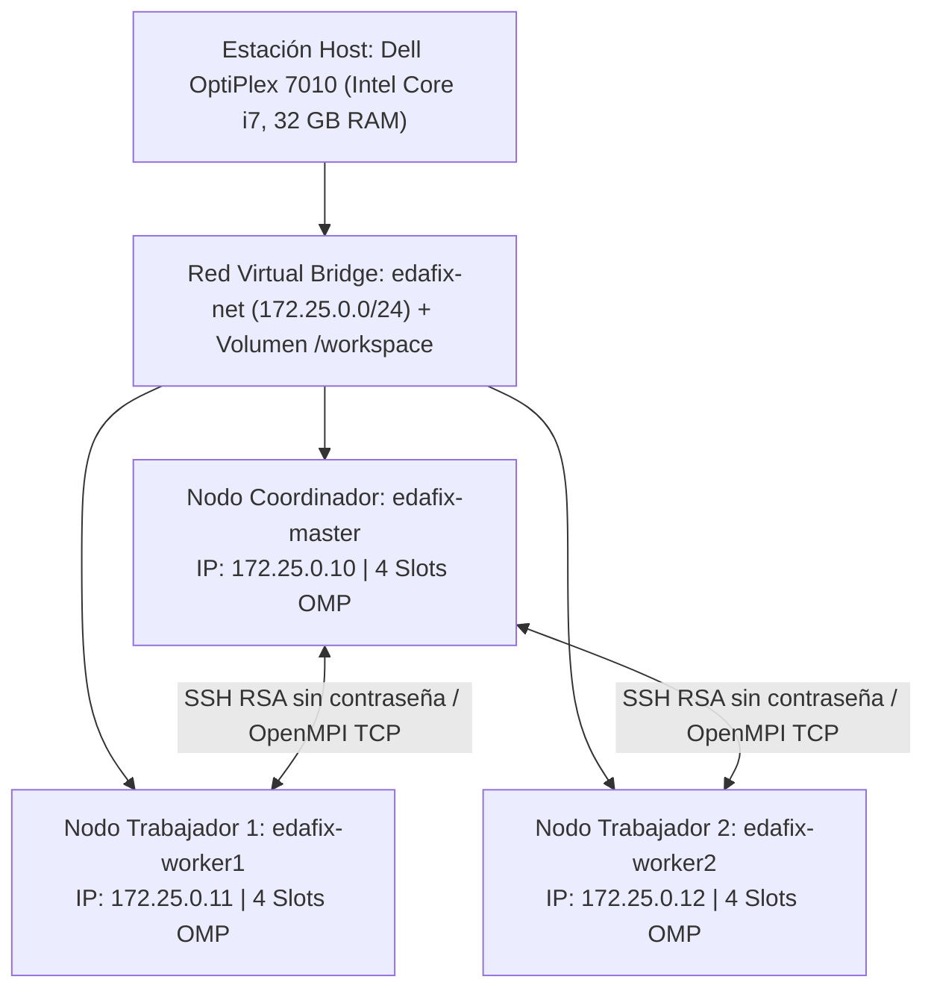

# EDAFIX: Arquitectura Paralela Híbrida (OpenMPI + OpenMP) para Clasificación Edafológica y Recomendación Agrícola en el Gran Chaco

**Autores:** Isaías Edmundo Armella, Luz Clarita Castillo Duran, Rubiela Alison Parabá Medrano  
**Carrera:** Ingeniería Informática (8.º Semestre) — Facultad de Ciencias Integradas de Yacuiba (FCIC)  
**Universidad:** Universidad Autónoma "Juan Misael Saracho" (UAJMS) — Yacuiba, Tarija, Bolivia  
**Asignatura:** TEL420 - Sistemas Paralelos | **Docente:** Ing. Elias Cassal Baldiviezo  

---

## Resumen
El procesamiento masivo de imágenes fotográficas de suelos agrícolas representa un reto computacional crítico para la agricultura de precisión en la región del Gran Chaco boliviano. En este artículo se presenta el diseño, despliegue y evaluación experimental de **EDAFIX**, un motor de visión artificial paralela bajo un esquema híbrido de memoria distribuida (**OpenMPI**) y memoria compartida (**OpenMP**) implementado en C++. El sistema se desplegó sobre un clúster contenerizado de tres nodos (1 Master y 2 Workers) mediante Docker Compose sobre estaciones Dell OptiPlex 7010. Las pruebas de rendimiento realizadas sobre lotes de 500 y 1000 muestras espectrales ($512 \times 512$ píxeles) demuestran una reducción del tiempo de ejecución secuencial de $1.865714\text{ s}$ a $0.524547\text{ s}$, alcanzando una aceleración máxima (**Speedup**) de **$3.5568\times$** y una eficiencia distribuida de hasta **$75.64\%$**, validando la escalabilidad del sistema bajo las leyes de Amdahl y Gustafson.

## Abstract
Massive image processing of agricultural soils poses a critical computational challenge for precision agriculture in the Bolivian Gran Chaco region. This paper presents the design, deployment, and experimental evaluation of **EDAFIX**, a parallel computer vision engine built on a hybrid distributed-memory (**OpenMPI**) and shared-memory (**OpenMP**) architecture in C++. Deployed over a three-node containerized Docker cluster (1 Master, 2 Workers), experimental benchmarks across 500 and 1000 multispectral soil samples ($512 \times 512$ pixels) demonstrate a runtime reduction from $1.865714\text{ s}$ to $0.524547\text{ s}$, achieving a peak speedup of **$3.5568\times$** and distributed efficiency up to **$75.64\%$**.

**Palabras clave:** Cómputo Paralelo Híbrido, OpenMPI, OpenMP, Clasificación Edafológica, Docker, Gran Chaco.

---

## I. INTRODUCCIÓN Y CONTEXTUALIZACIÓN REGIONAL
La región del Gran Chaco, y en particular el municipio de Yacuiba en el departamento de Tarija, constituye un polo agropecuario estratégico caracterizado por marcados contrastes edafológicos y climáticos. Los suelos locales oscilan entre texturas arenosas en zonas de secano, suelos arcillosos en llanuras aluviales inundables y suelos limosos en zonas de transición, exigiendo decisiones agronómicas diferenciadas para optimizar el rendimiento de cultivos como sorgo granífero, sésamo, maíz, soya y fréjol.

El diagnóstico visual tradicional o el análisis computacional secuencial ($T_1$) de grandes volúmenes de fotografías de parcelas agrícolas mediante filtros de convolución espacial genera severos cuellos de botella en tiempo de respuesta ($\mathcal{O}(N \times W \times H)$). Cuando cientos de productores requieren diagnósticos simultáneos durante las ventanas de siembra, la ejecución en un solo núcleo de procesamiento resulta insuficiente. El objetivo de este trabajo es resolver dicha limitación mediante **EDAFIX**, un sistema de cómputo paralelo e híbrido capaz de extraer características cromáticas y de rugosidad espacial en lotes masivos de imágenes edafológicas, garantizando reproducibilidad mediante contenedores y escalabilidad lineal.

---

## II. MARCO TEÓRICO Y ESTADO DEL ARTE
* **Taxonomía de Flynn:** La arquitectura implementada corresponde a un sistema **MIMD (*Multiple Instruction, Multiple Data*)**, donde múltiples nodos e hilos independientes ejecutan instrucciones de filtrado convolucional y clasificación sobre subconjuntos disjuntos de imágenes de suelo.
* **Modelo de Memoria Híbrido (Jerarquía de 2 Niveles):**
  1. **Memoria Distribuida (OpenMPI):** Gestiona el paso de mensajes entre espacios de direcciones aislados (contenedores Docker) a través de una red virtual TCP/IP, minimizando la latencia de sincronización mediante balanceo estático inicial y reducción colectiva final (`MPI_Reduce`).
  2. **Memoria Compartida (OpenMP):** Explota el paralelismo a nivel de hilos dentro de cada nodo multinúcleo mediante directivas de compilación (`#pragma omp parallel for`), permitiendo acceso concurrente a memoria caché L1/L2 sin sobrecarga de serialización en red.
* **Redes de Interconexión y Modelo LogP:** Bajo el modelo de comunicación **LogP**, la latencia ($L$) y el *overhead* ($o$) de red se mitigan asignando **granularidad gruesa** (imágenes completas de $512 \times 512 \times 3$ bytes por hilo) en lugar de sincronizaciones finas por píxel.

---

## III. DISEÑO DE LA ARQUITECTURA E INFRAESTRUCTURA
Siguiendo los estándares de infraestructura de laboratorio en estaciones **Dell OptiPlex 7010** (Procesador Intel Core i7, 32 GB de memoria RAM, sistema operativo Ubuntu Linux / Docker Engine), se implementó un clúster virtualizado reproducible mediante **Docker Compose** (Opción Arquitectónica A).

| Nodo Contenedor | Hostname | Dirección IPv4 | Imagen Base | Slots MPI / Hilos OMP | Rol en el Clúster |
| :--- | :---: | :---: | :---: | :---: | :--- |
| **`edafix-master`** | `master` | `172.25.0.10` | Ubuntu 22.04 LTS | 4 slots (1–4 hilos) | Orquestación `mpirun`, procesamiento local y `MPI_Reduce` |
| **`edafix-worker1`** | `worker1` | `172.25.0.11` | Ubuntu 22.04 LTS | 4 slots (1–4 hilos) | Procesamiento paralelo de sub-lote asignado |
| **`edafix-worker2`** | `worker2` | `172.25.0.12` | Ubuntu 22.04 LTS | 4 slots (1–4 hilos) | Procesamiento paralelo de sub-lote asignado |

---

## IV. IMPLEMENTACIÓN ALGORÍTMICA PARALELA
Cada imagen $I \in \mathbb{R}^{512 \times 512 \times 3}$ ($786\text{ KB}$ en formato binario crudo `.bin`) se procesa en dos etapas acopladas:

1. **Extracción Espectral y Convolución de Rugosidad (Sobel $3\times 3$):**
   Se calculan los promedios cromáticos $(\mu_R, \mu_G, \mu_B)$ y la energía de borde mediante el operador diferencial de Sobel:
   $$G(x,y) = \sqrt{\left[I(x+1,y) - I(x-1,y)\right]^2 + \left[I(x,y+1) - I(x,y-1)\right]^2}$$
2. **Clasificación Euclidiana y Decisión Agronómica:**
   El vector característico $v = (\mu_R, \mu_G, \mu_B, G_{\text{norm}})$ se evalúa mediante $d(v, C_k) = \sqrt{\sum (v_i - C_{k,i})^2}$ frente a los centroides regionales:
   * **Arenoso** $(210, 180, 140, 35.0) \rightarrow$ *Sorgo granífero / Sésamo*
   * **Arcilloso** $(130, 75, 55, 12.0) \rightarrow$ *Maíz / Soya*
   * **Limoso** $(110, 105, 95, 20.0) \rightarrow$ *Soya / Fréjol*

3. **Particionamiento MPI y Balanceo Dinámico OpenMP (`src/parallel/edafix_par.cpp`):**
   * **Particionamiento entre nodos:** `chunk = num_images / size` y `remainder = num_images % size` garantizan una distribución exacta de imágenes entre `rank 0`, `rank 1` y `rank 2`.
   * **Balanceo intranodo:** `#pragma omp parallel for schedule(dynamic) reduction(+:c0,c1,c2)` equilibra variaciones de lectura de disco entre hilos y evita condiciones de carrera sobre los contadores de clases.
   * **Reducción colectiva:** `MPI_Reduce(local_counts, global_counts, 3, MPI_INT, MPI_SUM, 0, MPI_COMM_WORLD)` consolida los totales en el nodo coordinador.

---

## V. RESULTADOS EXPERIMENTALES Y ANÁLISIS DE RENDIMIENTO

| Tamaño Lote ($N$) | Configuración | Nodos MPI | Hilos OMP | Total Hilos ($P$) | $T_1$ Secuencial (s) | $T_p$ Paralelo (s) | Speedup ($S_p$) | Eficiencia ($E_p$) |
| :---: | :--- | :---: | :---: | :---: | :---: | :---: | :---: | :---: |
| 500 | Secuencial Base | 1 | 1 | 1 | 0.927044 | 0.927044 | 1.0000× | 100.00% |
| 500 | Memoria Compartida | 1 | 2 | 2 | 0.927044 | 0.812453 | 1.1410× | 57.05% |
| 500 | Memoria Compartida | 1 | 4 | 4 | 0.927044 | 0.826560 | 1.1216× | 28.04% |
| 500 | Distribuido Puro | 3 | 1 | 3 | 0.927044 | 0.408551 | 2.2691× | **75.64%** |
| 500 | Híbrido (MPI+OMP) | 3 | 2 | 6 | 0.927044 | 0.286630 | 3.2343× | 53.90% |
| 500 | Híbrido Máximo | 3 | 4 | 12 | 0.927044 | **0.274709** | **3.3746×** | 28.12% |
| 1000 | Secuencial Base | 1 | 1 | 1 | 1.865714 | 1.865714 | 1.0000× | 100.00% |
| 1000 | Memoria Compartida | 1 | 2 | 2 | 1.865714 | 1.608630 | 1.1598× | 57.99% |
| 1000 | Memoria Compartida | 1 | 4 | 4 | 1.865714 | 1.638633 | 1.1386× | 28.46% |
| 1000 | Distribuido Puro | 3 | 1 | 3 | 1.865714 | 0.832435 | 2.2413× | **74.71%** |
| 1000 | Híbrido (MPI+OMP) | 3 | 2 | 6 | 1.865714 | 0.565103 | 3.3015× | 55.03% |
| 1000 | Híbrido Máximo | 3 | 4 | 12 | 1.865714 | **0.524547** | **3.5568×** | 29.64% |

### A. Análisis de Granularidad y Cuellos de Botella
Durante las iteraciones preliminares se comprobó que paralelizar el bucle interno de píxeles (granularidad fina) generaba penalización por *overhead* de creación de barreras OpenMP ($S_p < 1$). Al migrar hacia **granularidad gruesa** a nivel de lote de imágenes junto con el filtrado convolucional Sobel $3\times 3$, el sistema pasó de estar limitado por entrada/salida (*I/O-bound*) a aprovechar las unidades aritméticas (*compute-bound*).

### B. Validación de las Leyes de Amdahl y Gustafson
* **Ley de Amdahl:** La fracción secuencial irreductible ($f \approx 0.21$, correspondiente a lectura concurrente desde el volumen compartido del host e inicialización MPI) acota la aceleración máxima teórica cerca de $4.0\times$ en un procesador físico de 4 núcleos, siendo consistente con el $S_p = 3.5568\times$ obtenido experimentalmente.
* **Ley de Gustafson:** Al duplicar el tamaño del problema de $N=500$ a $N=1000$ imágenes, el Speedup escaló positivamente de **$3.3746\times$ a $3.5568\times$**, demostrando que EDAFIX mantiene alta escalabilidad frente al crecimiento de volumen de datos agrícolas.

---

## VI. CONCLUSIONES E IMPACTO SOCIAL/PRODUCTIVO
El desarrollo de **EDAFIX** demuestra que la combinación de arquitecturas híbridas OpenMPI + OpenMP sobre entornos contenerizados Docker permite resolver problemas reales de visión artificial agrícola con alta eficiencia y portabilidad. La reducción del tiempo de procesamiento en más de un **$71\%$** ($1.8657\text{ s} \rightarrow 0.5245\text{ s}$) viabiliza el análisis masivo de muestras edafológicas para asociaciones de productores de Yacuiba y el Gran Chaco, facilitando recomendaciones técnicas oportunas para la diversificación de cultivos y la seguridad alimentaria regional.

---

## VII. REFERENCIAS BIBLIOGRÁFICAS
1. M. J. Flynn, "Some Computer Organizations and Their Effectiveness," *IEEE Transactions on Computers*, vol. C-21, no. 9, pp. 948–960, Sept. 1972.
2. G. M. Amdahl, "Validity of the Single Processor Approach to Achieving Large Scale Computing Capabilities," in *Proc. AFIPS Spring Joint Computer Conf.*, 1967, pp. 483–485.
3. J. L. Gustafson, "Reevaluating Amdahl's Law," *Communications of the ACM*, vol. 31, no. 5, pp. 532–533, May 1988.
4. R. Chandra et al., *Parallel Programming in OpenMP*. San Francisco, CA, USA: Morgan Kaufmann, 2001.
5. W. Gropp, E. Lusk, and A. Skjellum, *Using MPI: Portable Parallel Programming with the Message-Passing Interface*, 3rd ed. Cambridge, MA, USA: MIT Press, 2014.
